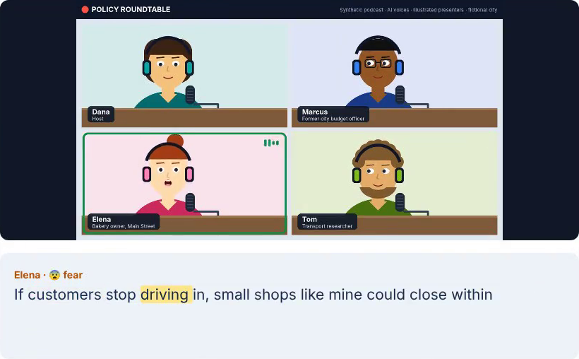
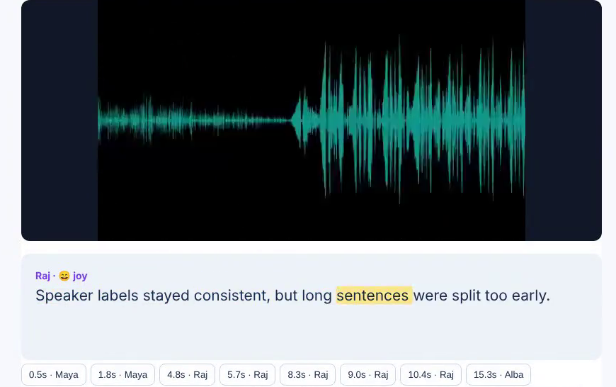

# Context Caption

**Context-aware captioning for multi-speaker media**

COSC-5926 — Advanced Human-Computer Interaction

A local Streamlit prototype that combines WhisperX transcription and forced word alignment,
pyannote speaker diarization, and optional transcript-based emotion cues in an editable caption workflow.

## Demo

### Four-person policy podcast

[](docs/demo/podcast_demo.mp4)

**[Watch the 3½-minute podcast demo (MP4, with sound)](docs/demo/podcast_demo.mp4).** Four presenters (Dana,
Marcus, Elena, Tom) debate a fictional city's plan to charge drivers entering downtown and fund free buses.
The 110-second video shows four illustrated presenters whose mouths follow their own voices, with two moments
of crosstalk. Real WhisperX, alignment, pyannote, and emotion models process it on CPU (shown 10× faster),
then the demo names the voices, corrects "$8 per corporate day" to "$8 per car per day", plays it back with
emoji emotion cues, and scores it against the script: **4.9% word error rate, 10.2% diarization error rate,
95.2% of words given the right speaker**. Auto-detecting the speaker count found all four. Misheard names
("Everton's", "Ilina") and speech under crosstalk still need human review.

### Three-voice meeting

[](docs/demo/app_demo.mp4)

**[Watch the 2-minute end-to-end demo (MP4, with sound)](docs/demo/app_demo.mp4).** A 41-second, three-voice
test recording goes through real WhisperX transcription, word alignment, pyannote diarization, and text
emotion on CPU (processing shown 8× faster). It then shows naming the voices, correcting a misheard word,
synchronized playback, seeking and search, exports, and the scores against the script: **2.9% word error rate,
25.7% diarization error rate, 73.3% of words given the right speaker**. The voices are synthetic, so these numbers
check the pipeline rather than accuracy on real conversation (see [docs/VALIDATION.md](docs/VALIDATION.md)).
Re-record either demo with `node scripts/record_app_demo.js --config examples/<name>.demo.json` while the app
runs with model access. All voices are synthetic and all people are illustrated; no real person is depicted.

## What you can do

- Upload audio/video; convert it to 16 kHz mono audio using FFmpeg.
- Transcribe speech and inspect original word timestamps and alignment scores.
- Split captions on word-level speaker changes, with consistent speaker labels and colors.
- Play media with synchronized captions, highlighted words, and click-to-seek controls.
- Rename speakers, edit text/timing/speaker assignments, and search the transcript.
- Optionally estimate English text emotion per speaker turn without modifying spoken content; cues show
  an emoji with the label (😠 anger, 🤢 disgust, 😨 fear, 😄 joy, 😐 neutral, 😢 sadness, 😮 surprise) in
  playback, the transcript, and opt-in SRT/VTT exports, e.g. `Raj [😄 joy]: Happy to be here.`
- Export speaker-aware SRT, styled VTT, or a JSON project retaining original words and edits.
- Reopen a JSON project and reattach its original media.
- Try a predefined two-voice synthetic demo without downloading ML models or providing a token.

## Start with the demo

The package supports Python 3.10–3.13, as specified in the project proposal. Python 3.11+ installs
Streamlit 1.66.1; Python 3.10 installs Streamlit 1.65.0, the last release supporting 3.10.
CI checks all four supported Python versions. Python 3.12 is the simplest match to local validation.

```bash
cd context-caption
python3 -m venv .venv
source .venv/bin/activate
python -m pip install --upgrade pip
python -m pip install -e .
python -m streamlit run app.py
```

On Windows, create the environment with `py -3.12 -m venv .venv` and activate it with
`.venv\Scripts\Activate.ps1` in PowerShell instead of the `source` command.

Open `http://localhost:8501` and select **Load sample project**. The supplied WAV contains
synthetic voices from FFmpeg's Flite filter. Its captions and word times are predefined for UI testing:
**they are not results of ASR or diarization**. Regeneration is optional; see `examples/create_demo.py`.

## Enable actual transcription and diarization

1. Install FFmpeg and confirm `ffmpeg -version` works.
   - macOS with Homebrew: `brew install ffmpeg`
   - Ubuntu/Debian: `sudo apt-get update && sudo apt-get install ffmpeg`
   - Windows: use an FFmpeg build linked from <https://ffmpeg.org/download.html> and add its `bin` to PATH.
2. In your active virtual environment, run:

   ```bash
   python -m pip install -e '.[ml]'
   ```

   This installs WhisperX 3.8.6, including its compatible PyTorch/pyannote dependencies, and Transformers.
   The demo UI and core tests do not require this extra. A resolved cross-platform ML lockfile is not
   included; native wheels depend on operating system and GPU. Keep this environment separate from
   existing MLX/LoRA installations.
3. Sign into Hugging Face and accept the access conditions at
   <https://huggingface.co/pyannote/speaker-diarization-community-1>.
4. Create a read token with permission to access that model. Enter it in the sidebar or set `HF_TOKEN`
   in your shell. Do not paste tokens into GitHub, captions, notebooks, or the README.
5. Start the app. Upload a short, clear recording with two consenting speakers, confirm permission,
   select **CPU / base / batch size 4**, and click **Generate captions**.
6. Review names, text, and times before exporting. Model downloads require internet on first use.

macOS, including Apple Silicon, uses the **CPU** backend here. This project does not use MLX or MPS.
For NVIDIA GPUs, install a PyTorch/CUDA runtime supported by your WhisperX installation before selecting
CUDA. Use the official [WhisperX setup guide](https://github.com/m-bain/whisperX#setup-) for platform details.
Start with `tiny` and batch size `1` if memory is limited. Allow 10–20 GB for dependencies and model caches.

Behind an HTTP proxy, NLTK (used by word alignment) refuses to download its sentence splitter. Fetch it once
with `python -m nltk.downloader punkt_tab` after setting `NLTK_ALLOW_PROXIED_URLOPEN=1`, or unzip
`punkt_tab.zip` from the nltk_data repository into `~/nltk_data/tokenizers/`. Voice activity detection
uses the pyannote model bundled with WhisperX, so it needs no download.

## Command line

After installing the ML extra and setting `HF_TOKEN`:

```bash
context-caption --input recording.mp4 --device cpu --model base --min-speakers 2 --max-speakers 2 --output outputs
```

Add `--emotions` for English text emotion estimates, or `--language en` to fix the language.
The token is read from the environment rather than a CLI argument.

Re-export the supplied JSON without ML models:

```bash
context-caption --project examples/demo_project.json --output outputs/demo
```

This produces `captions.srt`, `captions.vtt`, and `captions.json`. Outputs are ignored by Git.

## Synthetic test recordings

| Recording | Content |
| --- | --- |
| `examples/test_conversation.mp4` | 41 s, three voices (Maya, Raj, Alba): quick replies, a returning speaker, numbers, proper nouns; waveform video |
| `examples/podcast_policy.mp4` | 110 s, four voices (Dana, Marcus, Elena, Tom) debating a fictional congestion charge, with two moments of crosstalk; animated video of four illustrated presenters whose mouths follow their own voices and whose tiles light up while they speak |

Each has `<name>_reference.json` (the script with utterance times) and `<name>_output.json` (unedited
real-model output: WhisperX `base`, CPU, known speaker count, emotion on). Open an output in **Open saved
project** and attach its MP4 to review it without models, or process the MP4 yourself and score the result:

```bash
context-caption --input examples/podcast_policy.mp4 --model base --min-speakers 4 --max-speakers 4 --output outputs/podcast
context-caption-eval --reference examples/podcast_policy_reference.json --hypothesis outputs/podcast/captions.json
```

Regenerate the media with `pip install piper-tts` and `python scripts/make_test_recording.py --script podcast`
(or `--script conversation`). Piper output varies slightly per run, so the reference is regenerated with it.
Synthetic voices are cleaner than real conversation: these scores check the pipeline and do not claim
accuracy on real speech.

## Project structure

```text
app.py                         Streamlit upload/review/export interface
src/context_caption/
  schema.py                    Project, caption, and word data structures
  media.py                     Bounded FFmpeg conversion
  pipeline.py                  WhisperX → alignment → pyannote → optional emotion
  captions.py                  Speaker-aware cue building and atomic edits
  player.py                    Synchronized HTML media player
  exporters.py                 SRT, VTT, and JSON exports
  cli.py                       Local processing and project re-export CLI
  evaluate.py                  WER/DER/timestamp scoring against a reference project
scripts/make_test_recording.py  Synthetic test recordings (three-voice meeting, four-voice podcast) and references
scripts/podcast_scene.py        Animated four-presenter studio video for the podcast recording
scripts/record_app_demo.js      Records the narrated end-to-end demo (Playwright + FFmpeg)
examples/                      Synthetic demo project, test recordings, references, outputs, demo configs
tests/                         Core, media, pipeline, evaluation, and Streamlit tests
docs/                          Architecture, evaluation, validation, GitHub setup, and demo video
.github/workflows/ci.yml        Automated lint and tests
```

## Checks

```bash
python -m pip install -e '.[dev]'
python -m ruff check .
python -m unittest discover -s tests -v
```

Tests exercise caption behavior, import/export, security escaping, media conversion, the adapter with
stubbed ML modules, and the Streamlit editing flow. **Stubbed ML tests do not validate model quality**.
The optional real-model smoke test in [docs/EVALUATION.md](docs/EVALUATION.md) needs your model access.
CI installs the base/dev package, not GPU dependencies or gated models.
It uses Ubuntu 24.04 and an FFmpeg executable bundled in the `imageio-ffmpeg==0.6.0` wheel,
so media tests do not depend on Ubuntu package-mirror speed. Local users should still install
FFmpeg as described above.

## Important behavior and limits

- Diarization labels cluster voices within one recording. They do not establish real-world identities
  or link people across recordings. Manual speaker names are review annotations.
- Overlapping speech, accents, noise, short utterances, and rapid turns can reduce quality.
- A word without alignment remains explicitly untimed (`null`). It is not silently dropped or assigned
  a fabricated timestamp. Such words (often numbers or symbols) have no speaker evidence, so they stay
  in the surrounding caption instead of splitting it; their word record keeps speaker UNKNOWN. A cue made
  only of untimed words uses the original segment bounds for display and needs review.
- Cue length targets are 84 characters and six seconds. A single long token or fallback segment can
  exceed those targets; this is a prototype, not a broadcast subtitle compliance validator.
- Editing text or cue times disables word highlighting for that cue; original word timings remain
  available in JSON and the Word timestamps tab. Text edits clear stale emotion predictions.
- Emotion is inferred from English text, not vocal prosody or a person's internal state. Consecutive
  cues by the same speaker are classified together as one speaker turn, so short cues share their turn's
  label. Only predictions at confidence >= 0.60 are shown; low confidence stays unlabeled. Emotion is
  hidden by default. Non-English recordings skip emotion and report that status.
- Speaker colors come from a six-color palette. With more than six speakers, colors repeat; the
  speaker name is always shown with the color, so labels stay distinguishable.
- Words that diarization cannot attribute are labeled UNKNOWN rather than guessed from the nearest
  speaker. Assign them in Review & edit.
- SRT uses plain speaker names. VTT adds color classes; external players differ in styling support.
- Upload limit: 200 MiB; processing limit: 60 minutes. FFmpeg conversion times out after five minutes.
  Model inference is synchronous and may take much longer on CPU. There is no background queue/cancel.
- Playback embeds media in the local app and uses extra memory. Prefer short clips for class demos.
  Caption edits or other reruns reset playback position.
- Uploaded/converted files use temporary directories and are removed after processing. Media bytes and
  captions remain in the current session until cleared; save project JSON and media separately to resume.
  Model caches persist locally. No analytics or application-level external media API is included;
  third-party model libraries have their own download/telemetry behavior.
- No authentication or multi-user isolation is provided. Bind to localhost; this prototype is not ready
  to expose to the public internet.

## GitHub

Repository: **[dipaksinha1/context-aware-captioning](https://github.com/dipaksinha1/context-aware-captioning)**.

```bash
git clone https://github.com/dipaksinha1/context-aware-captioning.git
cd context-aware-captioning
```

Authenticate with your GitHub account if the repository is private.
See [docs/GITHUB_SETUP.md](docs/GITHUB_SETUP.md) for development and upload instructions.
The repository excludes access tokens, uploaded recordings, and downloaded model weights.

## References

### Literature (from the project proposal)

1. Ubur, S. D., et al. (2026). Speaker-Aware Affective Captioning for Multi-Speaker STEM Talk in
   Inclusive Classrooms. *CHI EA 2026*. <https://doi.org/10.1145/3772363.3798718>
2. Amorim, J., Pimentel, J., & Rudzicz, F. (2026). On the Limitations of Speaker Diarization.
   *Expert Systems, 43*(3), e70221. <https://doi.org/10.1111/exsy.70221>
3. Ubur, S. D., et al. (2025). Interpretive Caption: Real-Time Vocal Emotion Cues for DHH Users.
   *ASSETS 2025*. <https://doi.org/10.1145/3663547.3759697>
4. McDonnell, E. J., et al. (2024). "Caption It in an Accessible Way That Is Also Enjoyable."
   *CHI 2024*. <https://doi.org/10.1145/3613904.3642177>
5. de Lacerda Pataca, C., et al. (2024). Caption Royale: Exploring the Design Space of Affective
   Captions from the Perspective of Deaf and Hard-of-Hearing Individuals. *CHI 2024*.
   <https://doi.org/10.1145/3613904.3642258>
6. Bain, M., Huh, J., Han, T., & Zisserman, A. (2023). WhisperX: Time-Accurate Speech Transcription
   of Long-Form Audio. *INTERSPEECH 2023*. <https://doi.org/10.21437/Interspeech.2023-78>

### Software and models

- [WhisperX official repository and Python API](https://github.com/m-bain/whisperX)
- [pyannote.audio official repository](https://github.com/pyannote/pyannote-audio)
- [Speaker diarization community model](https://huggingface.co/pyannote/speaker-diarization-community-1)
- [English emotion model card](https://huggingface.co/j-hartmann/emotion-english-distilroberta-base)
- [Streamlit documentation](https://docs.streamlit.io/)

The implementation uses these existing models; it does not train a new speech recognition model.
Model licenses and access conditions apply separately. No license for redistribution of this project's
original source has been selected yet; choose one before sharing it publicly.
